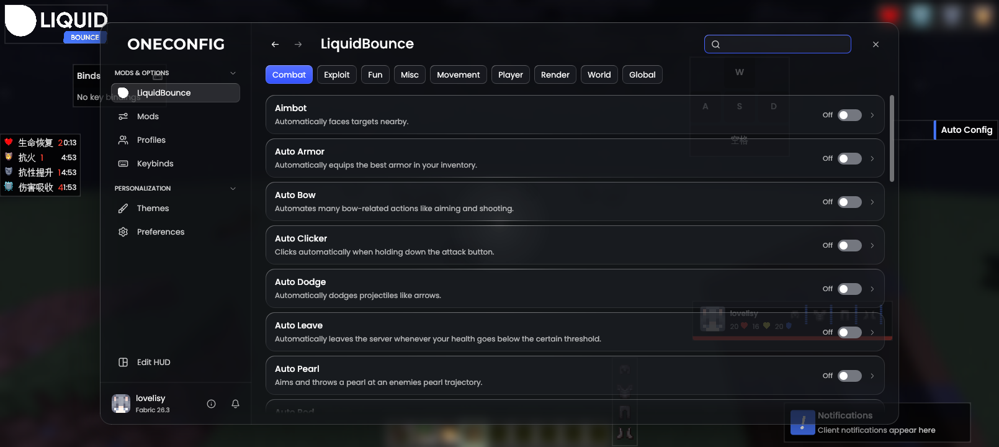
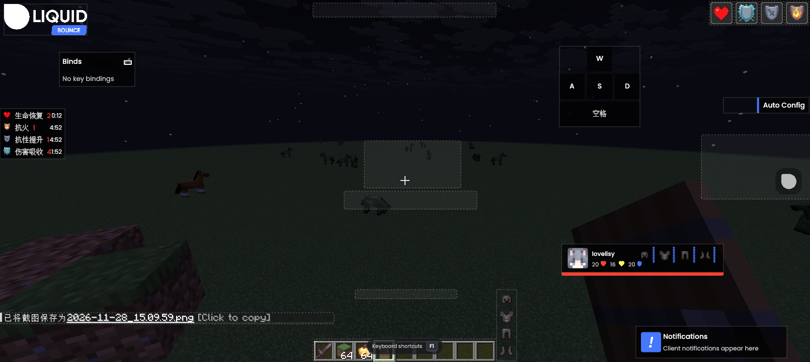

This build is a LiquidBounce fork that replaces the browser-based interface with
[OneConfig](https://github.com/Polyfrost/OneConfig). The module list and the in-game HUD are rendered by OneConfig, so
there is no embedded browser, no web server and no bundled front end.

## What is different

- **OneConfig instead of the WebUI.** The ClickGUI key opens the OneConfig screen, where a `LiquidBounce` card lists
  every module grouped by its category. Toggling a module there is the same as toggling it in game.
- **HUD through OneConfig.** The native HUD elements (target HUD, array list and notifications) are registered with
  OneConfig's HUD system, so they can be moved, scaled and restyled in OneConfig's HUD editor.
- **Removed:** the CEF browser backend, the Ktor interop server, the Svelte theme, the task/loading screens, the deep
  learning engine and the AI angle smooth rotation mode, the browser based Microsoft login and the local OAuth callback
  server.
- **No Node.js** is required to build, the theme is no longer compiled during `build`.

## License

This project is subject to the [GNU General Public License v3.0](https://www.gnu.org/licenses/gpl-3.0.en.html) (see
[LICENSE](LICENSE)). This applies only to source code located in this repository. During the development and
compilation process, additional source code may be used to which no rights have been obtained; such code is not
covered by the GPL license.

In short, under the GPL you are allowed to use, share and modify this source code, but if you decide to use any code
from it, you must disclose the source code of your modified work and license it under the GPL as well. This summary is
no legal advice nor legally binding.

The runtime dependencies are not bundled into this jar and keep their own licenses:

- [OneConfig](https://github.com/Polyfrost/OneConfig) is licensed under the GNU Lesser General Public License v3
  together with the Polyfrost additional terms.
- [PolyCompose](https://github.com/Polyfrost/PolyCompose) is licensed under the GNU Lesser General Public License v3
  together with the Polyfrost additional terms; OneConfig already depends on it.

## Requirements

- Minecraft 26.3 with Fabric Loader and Fabric Language Kotlin.
- [OneConfig](https://github.com/Polyfrost/OneConfig) 1.9.1 or newer must be installed, it provides the settings screen
  and the HUD renderer.
- [PolyCompose](https://github.com/Polyfrost/PolyCompose) 3.0.0 or newer must be installed. OneConfig ships it as a
  dependency of its own, so it is normally already present; LiquidBounce uses its immediate mode renderer to draw the
  HUD with OneConfig's font engine.
